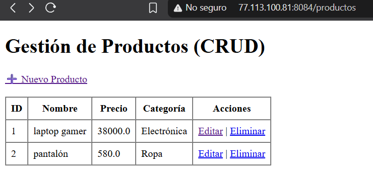
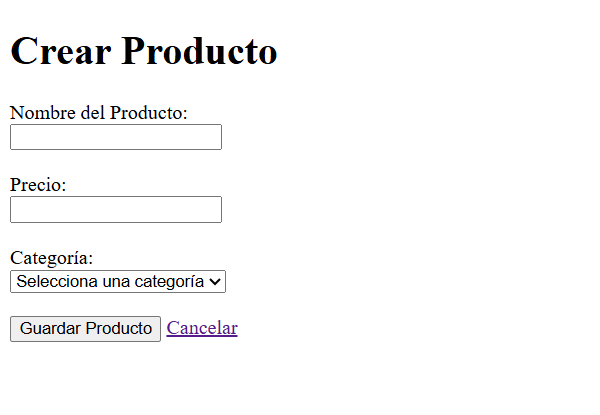
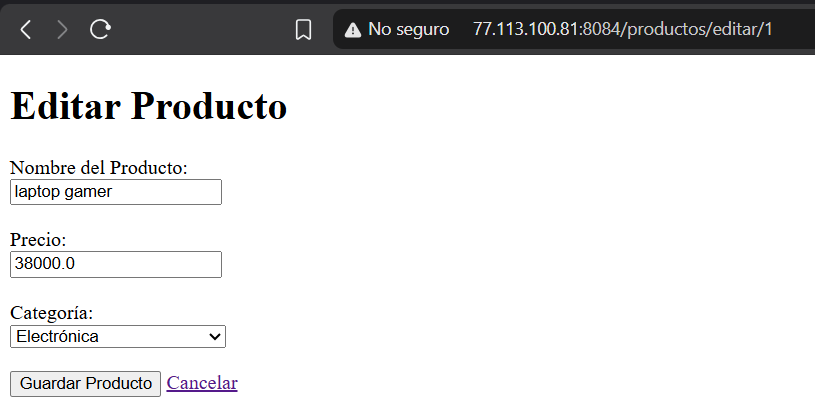
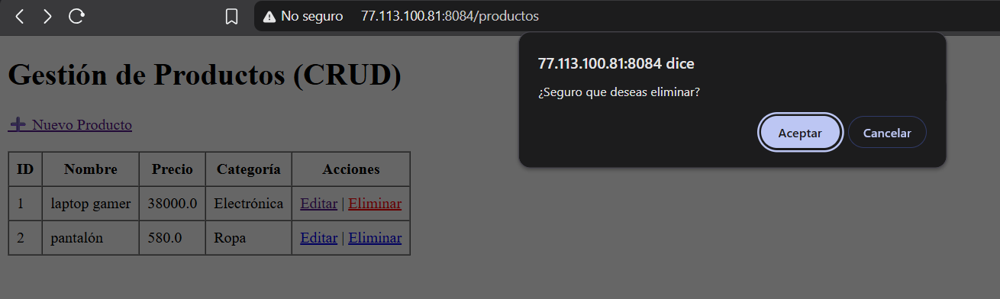

# Actividad 3: CRUD con Spring Boot, JPA y MySQL

Este proyecto implementa un CRUD completo (Crear, Leer, Actualizar, Eliminar) utilizando **Spring Boot**, **Spring Data JPA** y una base de datos real **MySQL**. Se implementó una relación de Uno a Muchos entre las entidades `Categoria` y `Producto`.

## 🛠️ Tecnologías utilizadas
* **Java 25 / Spring Boot** (Backend)
* **Spring Data JPA / Hibernate** (Persistencia de datos)
* **MySQL** (Base de datos real en el VPS)
* **Thymeleaf** (Motor de plantillas para las vistas HTML)
* **Maven** (Gestor de dependencias)

## ✨ Características implementadas
* **Relación de Entidades:** Una Categoría tiene muchos Productos (`@OneToMany`) y un Producto pertenece a una Categoría (`@ManyToOne`). La llave foránea `categoria_id` se genera automáticamente.
* **Capa de Servicio (Service):** La lógica de negocio está separada de los controladores para mantener un código limpio y reutilizable (`ProductoService`).
* **CRUD Completo:** Vistas funcionales de Thymeleaf para crear, listar, editar y eliminar productos.
* **Despliegue en AWS:** Proyecto corriendo en un VPS (Ubuntu) conectado a una base de datos MySQL real.

---

## 📸 Evidencia de Funcionamiento

### 1. Lista de productos (Leer) y relación con Categoría
*Se muestra la tabla con los productos guardados en MySQL. En la columna "Categoría" se muestra el nombre de la categoría (gracias a la relación @ManyToOne), no solo su ID.*

### 2. Formulario de creación (Crear)
*Formulario para dar de alta un nuevo producto, seleccionando su categoría desde un menú desplegable.*

### 3. Edición de producto (Actualizar)
*Pantalla para modificar los datos de un producto existente.*

### 4. Eliminación de producto (Eliminar)
*Producto eliminado de la base de datos y de la vista.*

---

## 🚀 Cómo ejecutar el proyecto en local
1. Clona este repositorio.
2. Crea una base de datos en MySQL llamada `tienda_db`.
3. Configura tus credenciales en `src/main/resources/application.properties`.
4. Ejecuta la clase principal `Vmzact3T4Application` desde tu IDE.
5. Abre tu navegador en `http://localhost:8084/productos`.

## 🌐 Despliegue en el VPS
El proyecto se encuentra desplegado y funcionando en el VPS de AWS, conectado a la base de datos MySQL del servidor:
* **URL del proyecto en vivo:** [http://77.113.100.81:8084/productos](http://77.113.100.81:8084/productos)